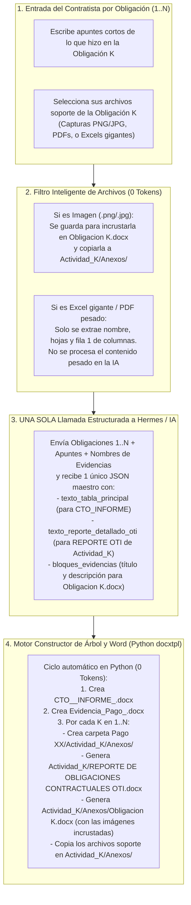

# Especificación Técnica Maestra: Sistema & Agente Generador de Cuentas de Cobro OTI - URT (`OTI-PayAgent`)

> **Propósito de este archivo:** Este documento es el **Contexto Maestro de Inicialización (Prompt & Arquitectura)** para construir desde cero la plataforma en **Django 5 + Python + Hermes Agent / LLM Fallback** encargada de automatizar la generación mensual de **TODO el conjunto de carpetas, subcarpetas `Actividad_1..N`, reportes individuales por actividad, compendios de anexos con capturas incrustadas y el informe de actividades principal** de los contratistas de la **Oficina de Tecnologías de la Información (OTI) – Unidad de Restitución de Tierras (URT)**, tomando como estándar exacto los **Pagos 9 (Septiembre) y 10 (Octubre) de 2026**.

---

## 1. REGLA CENTRAL INNEGOCIABLE: El Árbol Completo de Salida (Carpetas + Todos los Documentos)

La salida del sistema **NO es un solo archivo Word suelto**. Cuando un contratista con $N$ obligaciones contractuales (ej. $N = 9$) genera su cuenta de cobro del **Pago $X$**, el sistema debe entregar **automáticamente todo el árbol de carpetas y los $2N + 2$ documentos Word generados y cruzados entre sí**, exactamente como están estructurados los **Pagos 9 y 10** en `0. Evidencias\Pago 9` y `0. Evidencias\Pago 10`:

```text
PAQUETE_COMPLETO_PAGO_<XX>_CTO_<NUM>/
│
├── 1_DOCUMENTOS_CUENTA_DE_COBRO/                     <-- Para subir a SIGAF / SECOP II / Supervisor
│   ├── CTO_<NUM>_<NOMBRE>_INFORME_<XX>.docx          (Informe Principal consolidado con las N obligaciones)
│   └── Evidencia_Pago_<XX>.docx                      (Documento de Ruta NAS según Circular 0009 de 2024)
│
└── 2_CARPETA_NAS_EVIDENCIAS/
    └── Pago <XX>/                                    <-- Lista para copiar a \\10.10.36.17\...\PAGO <XX>
        │
        ├── Actividad_1/
        │   ├── REPORTE DE OBLIGACIONES CONTRACTUALES OTI.docx   <-- Reporte individual firmado de la Obligación 1
        │   └── Anexos/
        │       ├── Obligacion 1.docx                            <-- Documento con capturas incrustadas y explicadas
        │       ├── <captura_1.png>                              <-- Soportes originales puestos en su carpeta
        │       └── <documento_soporte.pdf / .xlsx>
        │
        ├── Actividad_2/
        │   ├── REPORTE DE OBLIGACIONES CONTRACTUALES OTI.docx   <-- Reporte individual firmado de la Obligación 2
        │   └── Anexos/
        │       ├── Obligacion 2.docx                            <-- Documento con capturas incrustadas y explicadas
        │       └── <soportes_originales_obligacion_2...>
        │
        ├── ... (Se repite automáticamente para cada obligación 3, 4, ..., N) ...
        │
        └── Actividad_N/
            ├── REPORTE DE OBLIGACIONES CONTRACTUALES OTI.docx   <-- Reporte individual firmado de la Obligación N
            └── Anexos/
                ├── Obligacion N.docx                            <-- Documento con capturas incrustadas y explicadas
                └── <soportes_originales_obligacion_N...>
```

> **¿Por qué esto es el corazón del negocio?**
> Porque para un contratista con 9 obligaciones, armar un pago implica redactar y formatear **20 documentos Word distintos** (`1` Informe Principal + `1` Ruta de Evidencias + `9` Reportes de Obligaciones OTI individuales + `9` documentos `Obligacion K.docx` con pantallazos pegados y explicados) y crear **18 carpetas** (`Actividad_1..9` y sus `Anexos/`). Nuestro sistema hace **todo ese trabajo en una sola pasada**.

---

## 2. Detalle Técnico de Cada Documento que Genera el Sistema (Basado en `plantillas_base/`)

En la carpeta `plantillas_base/` se encuentran los archivos reales del **Pago 9 y Pago 10** que sirven como molde exacto:

### A. Informe Principal Consolidado (`CTO_<NUM>_<NOMBRE>_INFORME_<XX>.docx`)
Molde base: `plantillas_base/CTO_1031_JOHN_VEGA_INFORME_10.docx`
* **Tabla 0 – Condiciones del Contrato:** Datos fijos del perfil del contratista + número de pago actual.
* **Tabla 1 – Obligaciones Contractuales ($N$ filas):**
  * Columna 1 (`No-`): `1` a `N`.
  * Columna 2 (`Obligación`): Texto literal de la obligación $K$.
  * Columna 3 (`Actividades Desarrolladas`): Resumen ejecutivo y técnico numerado (`1. ...`, `2. ...`) redactado por la IA con base en los apuntes y evidencias de la obligación $K$. *(Libre de etiquetas `<para>` o caracteres XML sin escapar para compatibilidad 100% con el motor ReportLab `GC-FO-15` de SIGAF)*.
  * Columna 4 (`Soportabilidad / Ruta de Acceso`): Ruta NAS exacta de esa actividad:
    `\\10.10.36.17\nivel_central\oti\4. sistemas de informacion\<AÑO>\01_Evidencias_OPS\<SUBCARPETA_ROL>\<NUM_CTO>_<AÑO>_CC_<CEDULA>_<APELLIDOS_NOMBRES>\PAGO <XX>\Actividad_<K>`
* **Tablas 2 y 3:** Control SECOP II y bloque de firma del supervisor.

### B. Reporte Individual por Actividad (`Pago <XX>/Actividad_<K>/REPORTE DE OBLIGACIONES CONTRACTUALES OTI.docx`)
Molde base: `plantillas_base/PLANTILLA_REPORTE_INDIVIDUAL_ACTIVIDAD_OTI.docx`
* Se genera **uno por cada carpeta `Actividad_K` ($K = 1 \dots N$)**.
* Contiene:
  * **Tabla de Información General:** Nombres y apellidos del contratista, Número del contrato, Periodo reportado (ej. `Octubre`), Fecha del reporte (ej. `28 de octubre de 2026`).
  * **Obligación Contractual:** El texto de la Obligación $K$.
  * **Descripción detallada de la ejecución de la obligación contractual:** Desarrollo técnico ampliado con viñetas (`•`) de lo realizado en esa obligación $K$, seguido de la lista detallada de los anexos ubicados en `\0. Evidencias\Pago <XX>\Actividad_<K>\Anexos` (citando el documento `Obligacion <K>.docx/.pdf` y cada archivo soporte).
  * **Firma digitalizada del contratista (`firma.jpg`)** + Nombre, Cédula y Fecha al pie.

### C. Compendio de Anexos y Capturas por Obligación (`Pago <XX>/Actividad_<K>/Anexos/Obligacion <K>.docx`)
Molde base: `plantillas_base/PLANTILLA_ANEXO_EVIDENCIAS_OBLIGACION.docx`
* Se genera **uno dentro de cada subcarpeta `Actividad_<K>/Anexos/` ($K = 1 \dots N$)**.
* Contiene:
  * **Encabezado:** `EVIDENCIAS Y ANEXOS TÉCNICOS – OBLIGACIÓN <K> (<MES> <AÑO>)` y subtítulo `Contrato N° <NUM> de <AÑO> | Contratista: <Nombre> | <Proyecto/Área>`.
  * **Secciones numeradas por cada evidencia/captura subida en esa obligación (`1. ...`, `2. ...`):**
    * Título técnico de la evidencia.
    * Párrafo explicativo formal redactado por la IA describiendo qué demuestra la evidencia.
    * **Incrustación automática de la imagen (`InlineImage` / `add_picture`)** si el soporte es una captura de pantalla (`.png`, `.jpg`, `.jpeg`), o referencia formal al archivo si es un `.pdf` / `.xlsx` adjunto en la misma carpeta `Anexos/`.

### D. Documento de Ruta NAS Circular 0009 de 2024 (`Evidencia_Pago_<XX>.docx`)
Molde base: `plantillas_base/Evidencia_Pago_10.docx`
* Contiene la ruta raíz del pago en la NAS (`\\10.10.36.17\...\PAGO <XX>`) y la imagen de captura del explorador de archivos mostrando las carpetas `Actividad_1` a `Actividad_N`.

*(Opcionalmente, si en el entorno local o Docker está instalado LibreOffice Headless o Microsoft Word en local, un paso automático convierte también los `.docx` generados a `.pdf` dentro de sus respectivas carpetas tal como están en los Pagos 9 y 10).*

---

## 3. ¿Cómo hacer que genere los $2N + 2$ documentos y todas las carpetas gastando MÍNIMOS Tokens?

El secreto de ingeniería para que generar **20 documentos Word por contratista** no gaste 20 llamadas a la IA ni sature el servidor con Excels pesados es separar **Redacción (IA)** de **Ensamblaje Documental y de Carpetas (Python + JS)**:



### Por qué este diseño es imbatible en costos y calidad:
1. **1 Sola Llamada a la IA produce el texto de los 20 documentos:**
   * En vez de llamar a la IA 20 veces, el prompt le pide un único JSON que trae por cada obligación $K$:
     * `resumen_tabla_principal`: para la celda de la tabla de `CTO_XXXX_INFORME_XX.docx`.
     * `desarrollo_detallado_oti`: para el cuerpo de `Actividad_K/REPORTE DE OBLIGACIONES CONTRACTUALES OTI.docx`.
     * `descripciones_anexos`: título y explicación técnica de cada captura/archivo para armar `Actividad_K/Anexos/Obligacion K.docx`.
   * Como los tres textos de la Obligación $K$ hablan de las mismas actividades del mes, la IA los redacta al mismo tiempo con total coherencia entre lo que dice el informe general, el reporte individual de la carpeta `Actividad_K` y el documento `Obligacion K.docx` dentro de `Anexos/`.
2. **Excels de 10 millones de filas nunca queman ni un token:**
   * Si en `Actividad_3/Anexos/` va un archivo `cargue_masivo_datos_contable.xlsx` de millones de filas, Python (`openpyxl(read_only=True)`) o `SheetJS` solo lee el nombre del archivo, las pestañas y los encabezados de la Fila 1 en 0.1 segundos. La IA redacta la explicación técnica citando las columnas exactas, y el archivo simplemente se ubica en la carpeta `Actividad_3/Anexos/` (o si se empaqueta desde el navegador con `JSZip`, ni siquiera consume red del VPS).
3. **Control total de usuarios y créditos mensuales:**
   * Sin chat libre.
   * Cada contratista activo en el mes tiene **3 generaciones completas del paquete** + **6 regeneraciones individuales de una obligación específica** (si corrige solo la Obligación 5, solo se regeneran los textos de la Obligación 5 y se actualiza el árbol de archivos en 3 segundos).
   * Cola FIFO (1 petición a la vez hacia **Hermes Agent `openai-codex` OAuth** con tu plan de \$20 USD, y **Fallback automático a API Key de Gemini 2.5 Flash / GPT-4o-mini** si en hora pico de cierre hay límite de tasa).

---

## 4. Datos Semilla Reales para el Piloto (Contrato 1031 - John Felipe Vega Otálora)

El script `seed_piloto_oti.py` precargará tus datos reales y tus **9 obligaciones del Contrato 1031** junto con los datos de ejemplo del **Pago 10 (Octubre 2026)**:

* **Contratista:** `John Felipe Vega Otalora` | **C.C.:** `1006552477`
* **Contrato:** `1031` | **Año:** `2026` | **Inicio:** `2026-01-13` | **Terminación:** `2026-11-30`
* **Objeto:** *"Prestar sus servicios de apoyo a la gestión con plena autonomía técnica y administrativa a la Oficina de Tecnologías de la Información, en el desarrollo, actualización, optimización e implementación de soluciones o componentes basados en inteligencia artificial."*
* **Supervisor:** `DIANA MARCELA RINCON LOPEZ` (`PROFESIONAL ESPECIALIZADO 2028 GRADO 17`)
* **Ruta Base NAS (Circular 0009 de 2024):**
  `\\10.10.36.17\nivel_central\oti\4. sistemas de informacion\2026\01_Evidencias_OPS\Desarrolladores\1031_2026_CC_1006552477_VEGA_OTALORA_JOHN_FELIPE`
* **Las 9 Obligaciones Específicas:**
  1. Desarrollar, actualizar, optimizar e implementar soluciones o componentes basados en inteligencia artificial, aplicando modelos de aprendizaje automático, procesamiento de lenguaje natural y análisis predictivo, conforme a los requerimientos funcionales del proyecto y los estándares tecnológicos establecidos.
  2. Validar que los componentes de desarrollo entregados se ajusten a los requerimientos, historias de usuario y criterios de aceptación establecidos durante la fase de análisis del proyecto.
  3. Proporcionar junto con la solución desarrollada, los scripts de ajuste de base de datos, configuración y demás documentos técnicos requeridos para llevar a cabo las pruebas de calidad y el despliegue en los entornos correspondientes.
  4. Formular cronogramas, estimar esfuerzos, implementar actividades planificadas y compilar informes detallados sobre las tareas de desarrollo ejecutadas.
  5. Gestionar la actualización continua y la documentación estructurada del código fuente en las ramas asignadas del repositorio GIT institucional.
  6. Asistir a los seguimientos programados de los proyectos asignados y actualizar las actividades en la herramienta de seguimiento.
  7. Gestionar y dar respuesta a los requerimientos e incidencias asignadas a través de la herramienta de mesa de servicios y/o correo electrónico reportando los seguimientos y soluciones implementadas.
  8. Asistir a reuniones en modalidad virtual o presencial, según las necesidades operativas y/o demandas del servicio.
  9. Las demás actividades que le sean encomendadas, necesarias para garantizar el cumplimiento de las obligaciones contractuales.

---

## 5. Plan de Ejecución para el Agente Constructor (Paso a Paso en Local)

1. **Entorno y Proyecto Django 5:**
   * Crear `.venv`, instalar `django docxtpl python-docx openpyxl pillow google-genai openai python-dotenv` y crear el proyecto Django `oti_cuentas`.
2. **Motor de Plantillas y Generador del Árbol Completo (`services/package_builder.py`):**
   * Convertir los archivos de `plantillas_base/` en plantillas dinámicas `docxtpl`:
     * `plantilla_informe_principal.docx` (basada en `CTO_1031_JOHN_VEGA_INFORME_10.docx`)
     * `plantilla_reporte_actividad_oti.docx` (basada en `PLANTILLA_REPORTE_INDIVIDUAL_ACTIVIDAD_OTI.docx`)
     * `plantilla_anexo_obligacion.docx` (basada en `PLANTILLA_ANEXO_EVIDENCIAS_OBLIGACION.docx`)
     * `plantilla_ruta_evidencias.docx` (basada en `Evidencia_Pago_10.docx`)
   * Programar `package_builder.py` para que dado un `InformeMensual` genere el árbol completo (`1_DOCUMENTOS_CUENTA_DE_COBRO/` + `2_CARPETA_NAS_EVIDENCIAS/Pago <XX>/Actividad_1..N/Anexos/...`) con todos los `.docx` e imágenes incrustadas y lo entregue listo en carpeta local y/o archivo `.zip`.
3. **Modelos, Control de Créditos y Seed Inicial:**
   * Crear modelos en Django, aplicar migraciones y correr `seed_piloto_oti.py` con el Contrato 1031.
4. **Interfaz Web Guiada + Botones "Copiar a SIGAF":**
   * Dashboard por contratista, formulario por obligación con carga de capturas/soportes, extractor de cabeceras para Excels gigantes (sin enviar filas a la IA), botón de regeneración individual por obligación, botones de copiado rápido a SIGAF y descarga del paquete completo de carpetas.
5. **Conector IA Dual (`services/ai_writer.py`):**
   * Conectar con Hermes Agent (`openai-codex` OAuth) en cola secuencial FIFO y API Key de respaldo (Gemini 2.5 Flash / OpenAI).
